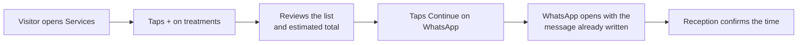

<p align="center">
  
</p>

<p align="center">
  
  
  
  
</p>

<p align="center">
  <a href="#what-the-site-does">What it does</a> ·
  <a href="#how-a-booking-works">How booking works</a> ·
  <a href="#pages">Pages</a> ·
  <a href="#edit-the-content">Edit content</a> ·
  <a href="#run-and-deploy">Run and deploy</a>
</p>

---

## What this is

The website for **Magic Touch Retreats**, a luxury spa, salon, nails and skincare studio with a beauty shop and academy at **Mbezi Beach, Dar es Salaam** (open daily, 9:00 AM to 8:00 PM).

Clients browse treatments and prices, add several to a list, and send the booking or product order straight to reception on **WhatsApp**. There is no backend, no accounts and no payment on the site. It is plain HTML, CSS and one JavaScript file, so it is cheap to host and quick to load on a phone.

## What the site does

| | Feature | What the visitor gets |
|---|---|---|
| 💆 | **Services and prices** | Nails, waxing, massage, skin care, hair and braids, with prices in TZS and sorting by price. |
| 🗓️ | **Multi-service booking** | Tap **+** on several treatments, review the list, then send one WhatsApp message. |
| 🎁 | **Offers** | Body package, couples package and a free skin consultation. |
| 🛍️ | **Shop** | Products grouped by service. Build a list and send one order on WhatsApp. |
| 🎓 | **Academy** | Courses in skincare, nails, makeup and hair styling, with an enquiry form that opens WhatsApp. |
| 🖼️ | **Gallery** | Real work from the studio's Instagram reels. |
| 📍 | **Find us** | Open-now indicator, map and ride-hailing links. |
| 🌍 | **Two languages** | English and Kiswahili, remembered between visits. |

## How a booking works



Nothing is sent until the visitor presses send in their own WhatsApp. The site stores only the language choice and the current list, in the browser's local storage.

## Pages

| File | Purpose |
|---|---|
| `index.html` | Home: hero, signature ritual, offers, work, reviews, FAQ |
| `services.html` | Full treatment list with prices and multi-booking |
| `offers.html` | Packages and promotions |
| `shop.html` | Products and the order list |
| `academy.html` | Courses and enquiry form |
| `gallery.html` | Instagram-based gallery |
| `contact.html` | Hours, map and contact |
| `privacy.html`, `terms.html`, `404.html` | Legal and error pages |

Supporting files: `app.js` (all behaviour, content and translations), `style.css`, `manifest.webmanifest` (installable app), `sitemap.xml`, `robots.txt`, and `_headers` (security and caching headers for Netlify or Cloudflare Pages).

## Edit the content

Almost everything a studio owner changes lives at the top of `app.js`, under `EDIT THESE`:

| Setting | What it controls |
|---|---|
| `WA` | WhatsApp number used by every booking and order button |
| `IG` | Instagram profile link |
| `POSTS` and `SVPOSTS` | Instagram reels shown in the gallery and on service sections |
| `D` | Service price list, one line per treatment as `name\|price text\|price number` |
| `PR` | Shop products, grouped by service |
| `AC` and `OF` | Academy courses and offer packages |
| `REVIEWS` | Client reviews. Add real reviews only. |
| `ADDRESS`, `HERO_IMG`, `SHEET_CSV` | Optional street address, hero photo, or a published Google Sheet for prices |
| `T` | Every piece of text, in English (`en`) and Kiswahili (`sw`) |

## Run and deploy

No build step. Open `index.html`, or serve the folder:

```bash
npx serve .
```

To deploy, upload the whole folder to any static host. `_headers` is read by Netlify and Cloudflare Pages.

## Credits

Designed and maintained by [Digidocs Official](https://www.digidocsofficial.com), the technology partner credited in the site footer.
